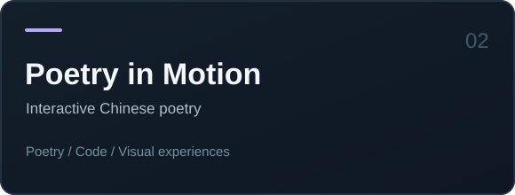

 

**Frontend Developer** &nbsp; / &nbsp; **AI Explorer** &nbsp; / &nbsp; **Indie Maker**

*Building practical tools, playful experiences, and things worth shipping.*

[Website · ToolkitFree](https://toolkitfree.net/) &nbsp; · &nbsp; [Creative Project · Poetry](https://shi.guoxueji.org/) &nbsp; · &nbsp; [Notes & Updates · X](https://x.com/ruofeng_x)

 

### 01 / A LITTLE ABOUT ME

Hey, I'm **Hew**. I work primarily with **React, TypeScript, and Node.js**, and I enjoy turning ideas into usable web products. Lately I've been exploring how **AI agents, automation, and creative coding** can make software more helpful — and more interesting.

I care about thoughtful interfaces, simple workflows, and shipping things that people can actually use.

### 02 / THINGS I'VE MADE

<table>
<tr>
<td width="50%" valign="top">
 
<b>ToolkitFree</b> 
A collection of practical online tools for everyday file and image tasks.  
<a href="https://toolkitfree.net/">Explore the tools ↗</a>
</td>
<td width="50%" valign="top">
 
<b>Poetry in Motion · 诗之境</b> 
Classical Chinese poetry reimagined as interactive, code-driven scenes.  
<a href="https://shi.guoxueji.org/">Experience the poetry ↗</a>
</td>
</tr>
</table>

### 03 / THE TOOLKIT

`TypeScript` &nbsp; `JavaScript` &nbsp; `React` &nbsp; `Node.js` &nbsp; `HTML/CSS` &nbsp; `Git` &nbsp; `Linux`

**Currently exploring** &nbsp; `AI Agents` &nbsp; `LLM Applications` &nbsp; `Automation` &nbsp; `Creative Coding`

### 04 / WHAT'S NEXT

I'm interested in the intersection of **useful software**, **AI-powered workflows**, and **independent products**. I share experiments, discoveries, and the occasional behind-the-scenes build note on [X / @ruofeng_x](https://x.com/ruofeng_x).

---

MAKE IT SIMPLE. MAKE IT USEFUL. KEEP BUILDING. © Hew · <a href="https://github.com/Hew007">GitHub</a> · <a href="https://x.com/ruofeng_x">X</a>

