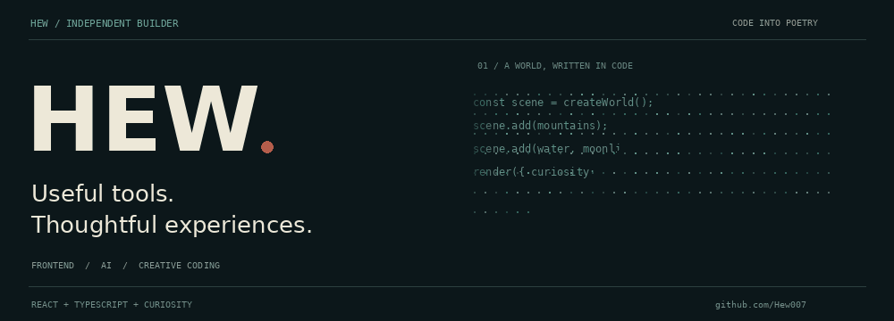

<picture>
  <source media="(prefers-reduced-motion: reduce)" srcset="assets/code-into-poetry.png" />
  
</picture>

I'm **Hew**, a frontend developer building practical web tools and interactive experiences. I explore AI through small implementations, hands-on tests, and reusable workflows.

[Poetry in Motion](https://shi.guoxueji.org/) · [ToolkitFree](https://toolkitfree.net/) · [Notes & updates on X](https://x.com/ruofeng_x)

 

### 01 / FEATURED EXPERIENCE

**诗之境 · Poetry in Motion**  
**Chinese poetry you can step into.**

Interactive scenes that bring classical Chinese poems to life through code. An exploration of language, landscape, and the feeling of being there.

[**Step into the poetry →**](https://shi.guoxueji.org/)

 

### 02 / SELECTED WORK

| ToolkitFree | Product Blueprint |
| :--- | :--- |
| Practical online tools for everyday file and image tasks. | A reusable AI skill that turns a rough product idea into a validated, actionable brief. |
| **Web product** · Everyday utilities | **Open-source skill** · Product thinking |
| [Explore the tools →](https://toolkitfree.net/) | [Explore the skill →](https://github.com/Hew007/product-blueprint-skill) |

 

### 03 / FROM THE LAB

Small implementations and hands-on tests exploring how AI works in practice.

**[Agent Dreaming](https://github.com/Hew007/agent-dreaming-demo)**  
A minimal TypeScript demo of layered agent memory and offline consolidation. Includes a mock mode to explore the data flow without an API key.

**[Woof Browser Bench](https://github.com/Hew007/woof-browser-bench)**  
Browser speech-generation experiments with recorded measurements, raw results, and explicit limitations.

 

### 04 / BEHIND THE BUILDS

I work primarily with **React, TypeScript, and Node.js**. I'm interested in thoughtful interfaces, creative coding, and AI workflows that make building more useful and more interesting.

I share experiments and build notes on **[X / @ruofeng_x](https://x.com/ruofeng_x)**.

---

CRAFT / CODE / CURIOSITY · Built by Hew
