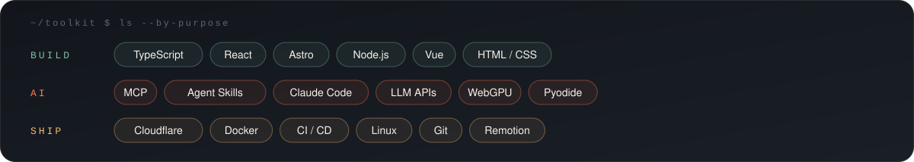

<div align="center">



<br />

[**X @ruofeng_x**](https://x.com/ruofeng_x) &nbsp;·&nbsp; [**ToolkitFree**](https://toolkitfree.net/) &nbsp;·&nbsp; [**诗之境**](https://shi.guoxueji.org/) &nbsp;·&nbsp; [**Blog**](https://hew007.github.io/) &nbsp;·&nbsp; [**Email**](mailto:807525311@qq.com)

</div>

<br />

### 01 / HELLO

I'm **Hew**, a frontend engineer who now spends most of my time building **for and with AI agents**.

My day job is **React + TypeScript**. My side job is figuring out what agents actually need to be useful: eyes on the browser (**MCP**), a repeatable way of thinking (**Agent Skills**), memory that doesn't rot (**dreaming**), and models small enough to run **on your own device**. Then I ship the results as tools real people can use.

```ts
const hew = {
  building: ["MCP servers", "Agent Skills", "in-browser AI"],
  shipping: ["ToolkitFree", "诗之境 · Poetry in Motion"],
  believes: "Verify, don't vibe. Ship small, ship often.",
} as const;
```

### 02 / AI LAB

<sub>Experiments in making agents more capable. Each one is small, readable, and runnable.</sub>

<table>
<tr>
<td width="50%" valign="top">
<a href="https://github.com/Hew007/chrome-debug-mcp"></a>
<sub>An MCP server that lets Claude Code / Cursor attach to a running Chrome tab, read console errors, run JS, and <b>verify their own fixes</b> with one <code>reload_and_check</code>.</sub>
</td>
<td width="50%" valign="top">
<a href="https://github.com/Hew007/product-blueprint-skill"></a>
<sub>An Agent Skill that runs a 14-step requirements process: it searches real competitors, checks platform limits, and <b>forces you to resolve contradictions</b>. Tested on Claude Code &amp; Codex.</sub>
</td>
</tr>
<tr>
<td width="50%" valign="top">
<a href="https://github.com/Hew007/agent-dreaming-demo"></a>
<sub>A minimal TypeScript take on layered agent memory and offline <b>“dreaming”</b> consolidation. Plain files, no vector DB, works with Anthropic or any OpenAI-compatible API.</sub>
</td>
<td width="50%" valign="top">
<a href="https://github.com/Hew007/woof-browser-bench"></a>
<sub>Measured, not guessed: a 30–40 MB TTS model running fully offline in the browser. WebGPU reaches first audio <b>12–23× faster</b> than CPU/WASM.</sub>
</td>
</tr>
</table>

### 03 / SHIPPED

<sub>Products that are live and used by real people.</sub>

<table>
<tr>
<td width="50%" valign="top">
<a href="https://toolkitfree.net/"></a>
<sub>Free online image, PDF and video tools: background remover, image → PDF, splitter, compressor and more. Processing happens <b>in your browser</b>. &nbsp;<a href="https://toolkitfree.net/">toolkitfree.net ↗</a></sub>
</td>
<td width="50%" valign="top">
<a href="https://shi.guoxueji.org/"></a>
<sub>Classical Chinese poems turned into interactive, code-driven scenes, where culture meets creative coding. &nbsp;<a href="https://shi.guoxueji.org/">shi.guoxueji.org ↗</a></sub>
</td>
</tr>
</table>

**In the workshop** &nbsp;→&nbsp; [`glim`](https://github.com/Hew007/glim): press, glance, go, a minimal word-lookup &amp; translation tool for Windows &nbsp;·&nbsp; playful early-learning animations for kids, built with Remotion

### 04 / TOOLKIT



### 05 / ACTIVITY

<picture>
  <source media="(prefers-color-scheme: dark)" srcset="https://raw.githubusercontent.com/Hew007/Hew007/output/snake-dark.svg" />
  <source media="(prefers-color-scheme: light)" srcset="https://raw.githubusercontent.com/Hew007/Hew007/output/snake-light.svg" />
  
</picture>

### 06 / LET'S TALK

I write about **AI agents, dev tools, and indie building**, including experiments, benchmarks, and behind-the-scenes notes. Find me on [**X @ruofeng_x**](https://x.com/ruofeng_x), or open an issue on any repo if something here sparks an idea.

---

<div align="center"><sub>MAKE IT USEFUL · VERIFY IT · KEEP SHIPPING</sub><br/><sub>© Hew · <a href="https://github.com/Hew007">GitHub</a> · <a href="https://x.com/ruofeng_x">X</a></sub></div>
