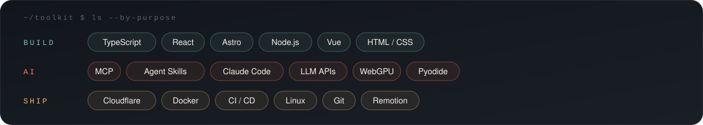

<div align="center">



<br />

[**X @ruofeng_x**](https://x.com/ruofeng_x) &nbsp;·&nbsp; [**ToolkitFree**](https://toolkitfree.net/) &nbsp;·&nbsp; [**诗之境**](https://shi.guoxueji.org/) &nbsp;·&nbsp; [**博客**](https://hew007.github.io/) &nbsp;·&nbsp; [**邮件**](mailto:807525311@qq.com)


[English](README.md) | **简体中文**

</div>

<br />

### 01 / 关于我

我是 **Hew**，一名前端工程师。现在，我把大部分时间花在**和 AI Agent 一起做东西，也为它们做工具**。

白天用 **React + TypeScript** 写前端。业余时间，我在琢磨怎么让 Agent 真正派上用场：用 **MCP** 看见浏览器，用 **Agent Skills** 复用工作流程，用 **dreaming** 定期整理记忆，让小模型直接跑在**自己的设备上**。做出来以后，我会把它们变成别人也能用的工具。

```ts
const hew = {
  building: ["MCP servers", "Agent Skills", "in-browser AI"],
  shipping: ["ToolkitFree", "诗之境 · Poetry in Motion"],
  believes: "Verify, don't vibe. Ship small, ship often.",
} as const;
```

### 02 / AI 实验室

<sub>一些让 Agent 更好用的小实验。每个项目都尽量小，看得懂，也能运行。</sub>

<table>
<tr>
<td width="50%" valign="top">
<a href="https://github.com/Hew007/chrome-debug-mcp"></a>
<sub>让 Claude Code 或 Cursor 连到正在运行的 Chrome 标签页，读取控制台错误、执行 JavaScript，并用 <code>reload_and_check</code> <b>自行验证修复</b>的 MCP 服务。</sub>
</td>
<td width="50%" valign="top">
<a href="https://github.com/Hew007/product-blueprint-skill"></a>
<sub>一个按 14 步梳理产品需求的 Agent Skill。它会查真实竞品、核实平台限制，并让你<b>解决有冲突的需求</b>。已在 Claude Code 和 Codex 上测试。</sub>
</td>
</tr>
<tr>
<td width="50%" valign="top">
<a href="https://github.com/Hew007/agent-dreaming-demo"></a>
<sub>用 TypeScript 演示 Agent 的分层记忆和离线 <b>dreaming</b> 整理。记忆用普通文件保存，支持 Anthropic 和 OpenAI 兼容 API。</sub>
</td>
<td width="50%" valign="top">
<a href="https://github.com/Hew007/woof-browser-bench"></a>
<sub>实测一个 30–40 MB 的 TTS 模型在浏览器断网后的表现。WebGPU 的首音延迟是 CPU/WASM 的约 <b>1/12–1/23</b>。</sub>
</td>
</tr>
</table>

### 03 / 已上线

<sub>已经上线、有人在用的产品。</sub>

<table>
<tr>
<td width="50%" valign="top">
<a href="https://toolkitfree.net/"></a>
<sub>免费在线图片、PDF 和视频工具，包括背景移除、图片转 PDF、拆分和压缩等。文件<b>在浏览器本地</b>处理。 &nbsp;<a href="https://toolkitfree.net/">toolkitfree.net ↗</a></sub>
</td>
<td width="50%" valign="top">
<a href="https://shi.guoxueji.org/"></a>
<sub>用代码把中国古诗做成可交互的动态场景。 &nbsp;<a href="https://shi.guoxueji.org/">shi.guoxueji.org ↗</a></sub>
</td>
</tr>
</table>

**还在做** &nbsp;→&nbsp; [`glim`](https://github.com/Hew007/glim): 按一下，看一眼，走：Windows 上的极简划词翻译和查词工具 &nbsp;·&nbsp; 用 Remotion 做的儿童启蒙动画

### 04 / 技术栈



### 05 / 活动

<picture>
  <source media="(prefers-color-scheme: dark)" srcset="https://raw.githubusercontent.com/Hew007/Hew007/output/snake-dark.svg" />
  <source media="(prefers-color-scheme: light)" srcset="https://raw.githubusercontent.com/Hew007/Hew007/output/snake-light.svg" />
  
</picture>

### 06 / 联系我

我写 **AI Agent、开发工具和独立开发**，记录实验、实测和项目背后的过程。可以在 [**X @ruofeng_x**](https://x.com/ruofeng_x) 找到我，也欢迎去对应仓库提 Issue。

---

<div align="center"><sub>做有用的东西，动手验证，持续发布</sub><br/><sub>© Hew · <a href="https://github.com/Hew007">GitHub</a> · <a href="https://x.com/ruofeng_x">X</a></sub></div>
